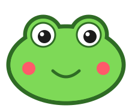

# Sapo 🐸

Mascota-asistente de escritorio gratis y de código abierto: un sapito que vive encima de tu pantalla, brinca sobre tus ventanas, te roba el cursor con la lengua cuando lo ignoras y, pronto, te escucha ("oye sapo"), controla tu PC y tu celular y contesta WhatsApp por ti cuando estás ocupado. Todo local, sin telemetría.



## Estado

Fase 1 en progreso: el sapo en Windows.

- Ventana transparente encima de todo; solo el sapo recibe clics.
- Cuerpo de gelatina que se aplasta y rebota.
- Brinca sobre los bordes de las ventanas y las sigue si las mueves.
- Lo agarras y lo avientas; un clic lo acaricia.
- Si lo ignoras se aburre: te jala el cursor y las ventanas con la lengua y pisotea ventanas.
- Con un juego o video en pantalla completa se duerme y no toca nada (si es en su monitor, se esconde).

Fase 2 (cerebro): IA local con Ollama (`qwen3.5:4b` en GPU, `qwen3.5:2b` en CPU durante juegos, Groq opcional con tu key), personalidad sarcástica, memoria SQLite, vida propia y burbujas de diálogo. Voz con "oye sapo" y respuestas habladas, y control de la PC (apps, web, volumen, música, recordatorios, ventanas, "qué hay en mi pantalla", apagar con confirmación). Ver [brain/README.md](brain/README.md).

Ver [docs/PLAN.md](docs/PLAN.md) y [docs/DECISIONES.md](docs/DECISIONES.md).

## Atajos

| Tecla | Acción |
|---|---|
| Ctrl+Alt+S | Calmar / despertar |
| Ctrl+Alt+Q | Cerrar |

## Correr desde el código

Requisitos: Windows 10/11, [Godot 4.7 .NET](https://godotengine.org/download/windows/), .NET SDK 8+.

```
cd pc
dotnet build
Godot_v4.7.2-stable_mono_win64.exe --path . -- --monitor=0
```

Opciones: `--monitor=N`, `--point=x,y` (monitor que contiene ese punto), `--boredom=0..1`.

## Licencia

MIT.
