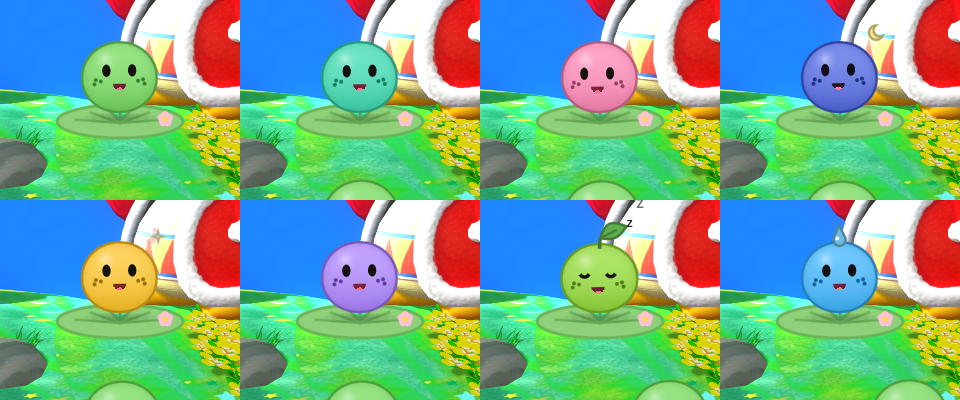

# Sapo 🐸

Un sapito que vive en tu escritorio de Windows. Brinca sobre tus ventanas, se aburre si lo ignoras, platica contigo por voz o por texto, comenta lo que estás haciendo y le puedes pedir cosas a tu PC. Gratis, de código abierto y sin telemetría.



## Qué hace

- Vive encima de todo en una ventana transparente; solo el sapo recibe clics. Lo arrastras entre monitores, lo avientas y rebota como gelatina.
- Se sienta en tus ventanas: si maximizas la de abajo se cae, si la mueves se tambalea, si minimizas una se asusta.
- Nenúfar: lo fijas en cualquier lugar y ahí se queda.
- "Oye sapo": te escucha y te contesta con voz (Gemini o voz local). Doble clic para escribirle.
- Comenta lo que tienes al frente, como mucho una vez cada 10 minutos, y se calla en juegos, llamadas y pantalla completa.
- Hace cosas en la PC: abrir apps y páginas, volumen, música, recordatorios, notas y ventanas. Lo irreversible (apagar, borrar) siempre te lo pregunta.
- Le sueltas un archivo encima y te lo resume.
- "Sapo clipea eso": guarda los últimos 30 s de pantalla con audio, también de juegos en pantalla completa exclusiva (vía OBS).
- Croacs propios, 8 diseños, tres niveles de energía y tres tamaños.

## Instalar

1. Descarga `Sapo-Setup-<versión>.exe` de [Releases](https://github.com/yokyznt/sapo-jarvis/releases) y ábrelo. No pide administrador.
2. Windows puede mostrar "Windows protegió tu PC" porque el instalador no está firmado: **Más información → Ejecutar de todas formas**.
3. Abre **Sapo Preferencias** desde el menú Inicio para configurarlo. El icono del sapo en la bandeja tiene Preferencias, Calmar, Fijar, Clipear, Ocultar y Salir.

La voz local necesita unos 510 MB de modelos que se bajan aparte la primera vez.

## Cerebro: Gemini o local

- **Gemini (recomendado):** saca una key gratis en [aistudio.google.com/apikey](https://aistudio.google.com/apikey) y pégala en Preferencias → Cerebro. Se guarda cifrada con DPAPI de Windows, nunca en texto plano. En el plan gratis Google puede usar lo que le mandes para mejorar sus productos.
- **Local:** sin key usa [Ollama](https://ollama.com) (`qwen3.5:4b`) y voz local. Si Gemini falla o se acaba el cupo, cambia a local solo.

## Clips

Actívalos en Preferencias → Clips.

| Método | Pantalla completa exclusiva | Notas |
|---|---|---|
| OBS (por defecto si lo tienes) | Sí | Usa tu OBS escondido con Game Capture; compatible con anti-cheat |
| Sapo (FFmpeg) | No | Ligero, usa NVENC/AMF/QSV |
| Medal / Game Bar | Depende | Simula su atajo; algunos anti-cheat lo ven mal |

## Privacidad

- Todo corre en tu PC salvo lo que mandes a Gemini si lo activas.
- Lista negra editable: nunca comenta ni captura bancos, gestores de contraseñas, WhatsApp, correo ni ventanas de incógnito.
- No lee archivos `.env`, llaves ni carpetas `.ssh`.
- El cerebro solo escucha en `127.0.0.1` y rechaza conexiones desde páginas web.

## Atajos

| Acción | Qué hace |
|---|---|
| Clic derecho en el sapo | Menú: nenúfar, dormir, diseño, energía, tamaño, salir |
| Doble clic | Escribirle |
| Ctrl+Alt+S | Calmar / despertar |
| Ctrl+Alt+Q | Cerrar |

## Desarrollo

| Carpeta | Qué es |
|---|---|
| `pc/` | El sapo: Godot 4.7 .NET (C#) |
| `brain/` | Cerebro, voz y clips: Python 3.12 con uv ([brain/README.md](brain/README.md)) |
| `settings/` | Preferencias: pywebview ([settings/README.md](settings/README.md)) |
| `installer/` | Inno Setup y empaquetado PyInstaller |
| `docs/` | Plan por etapas, decisiones y configuración ([docs/config.md](docs/config.md)) |

```
cd pc && dotnet build
Godot_v4.7.2-stable_mono_win64.exe --path pc -- --point=960,540
cd brain && uv run sapo-brain
cd brain && uv run pytest
python scripts/build_release.py
```

`build_release.py` necesita Godot 4.7 mono con export templates, uv e Inno Setup 6. Guía para contribuir: [CONTRIBUTING.md](CONTRIBUTING.md).

## Licencia

MIT. Componentes de terceros y sus licencias: [docs/CREDITOS.md](docs/CREDITOS.md).

## English

Sapo is a free, open-source desktop frog for Windows. It hops on your windows, talks (Gemini or fully local with Ollama and sherpa-onnx voices), comments on what you're doing with strict privacy rules, controls your PC with confirmation for irreversible actions, summarizes dropped files, and clips your last 30 seconds (including exclusive fullscreen games via OBS). Download the installer from Releases; no admin rights needed.
